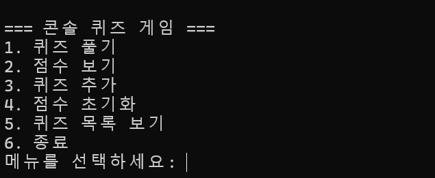
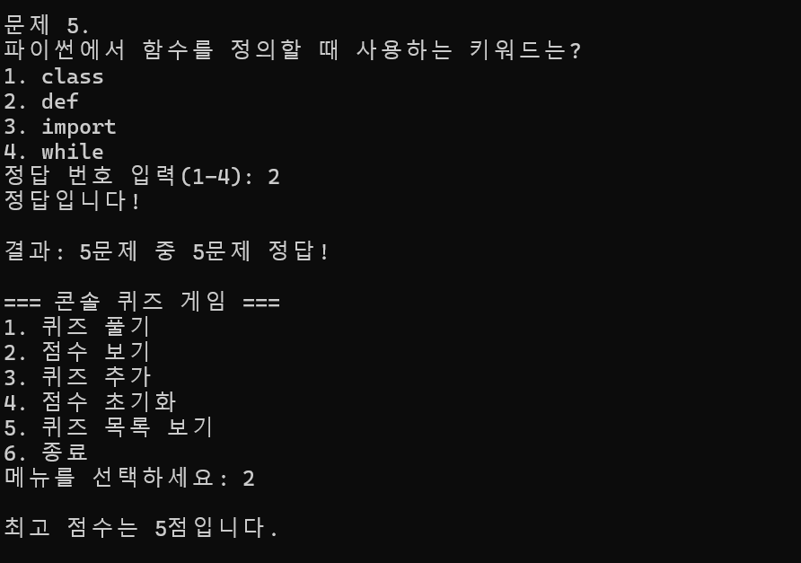
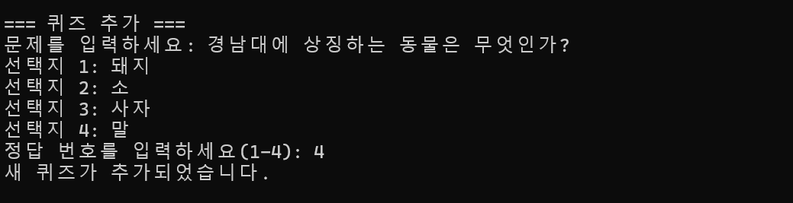
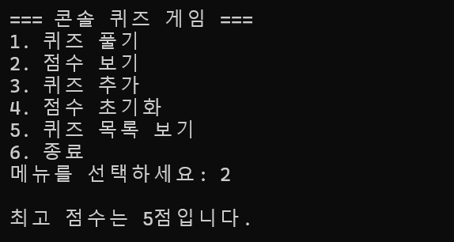

# 콘솔 퀴즈 게임

## 프로젝트 개요
Python으로 만든 콘솔 기반 객관식 퀴즈 게임입니다.
사용자는 메뉴를 통해 퀴즈 풀기, 퀴즈 추가, 퀴즈 목록 보기, 최고 점수 확인을 할 수 있습니다.

## 퀴즈 주제 선정 이유
Python 기초 문법을 복습하기 위해 파이썬 기본 문법을 주제로 선정했습니다.
출력, 리스트, 조건문, 반복문, 함수 등 학습 초기에 중요한 개념을 퀴즈로 확인할 수 있습니다.

## 실행 방법
```bash
py main.py
```
## 기능 목록
```
객관식 퀴즈 풀기
퀴즈 추가
퀴즈 목록 보기
최고 점수 확인
최고 점수 초기화
잘못된 숫자 입력 처리
state.json 파일 저장 및 불러오기
```
## 파일 구조
```
프로젝트 폴더/
├── main.py
├── state.json
├── README.md
├── .gitignore
└── docs/
    └── screenshots/
        ├── menu.png
        ├── play.png
        ├── add_quiz.png
        └── score.png
```
## 데이터 파일 설명
```
데이터는 프로젝트 루트의 state.json 파일에 저장됩니다.
데이터 파일의 내용
{
    "best_score": 3,
    "quizzes": [
        {
            "question": "파이썬에서 출력할 때 사용하는 함수는?",
            "choices": ["print", "input", "len", "type"],
            "answer": 1
        }
    ]
}
```
## 필드 설명
```
best_score: 최고 점수
quizzes: 퀴즈 목록
question: 문제 내용
choices: 4개의 선택지
answer: 정답 번호, 1부터 4까지의 숫자
```
## 실행 화면

### 메인 메뉴 화면


### 퀴즈 풀이 화면


### 퀴즈 추가 화면


### 최고 점수 화면


## 개발 환경
```
- Python 3.15.2 
- 외부 라이브러리 사용 없음
- 데이터 저장 파일: state.json
```